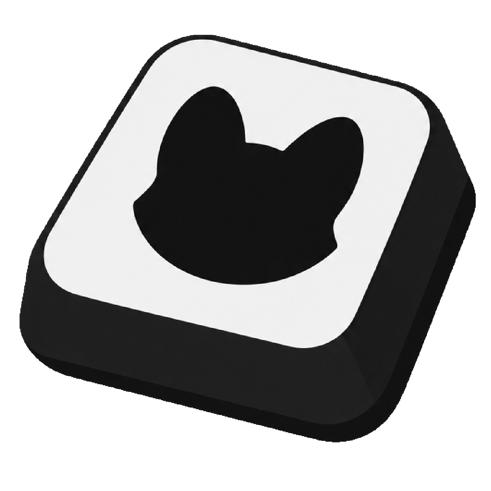

    

    

    <h3>输入可视化覆盖层工具。</h3>
    <h3>实时显示键盘、鼠标和 Xbox 兼容手柄操作，适用于直播、录制、教学和操作展示。</h3>

## 下载与运行

1. 打开最新 Release 页面：https://github.com/PA-Keystroke/PA-Keystroke-Releases/releases/latest
2. 或者访问官网：https://pa-keystroke.github.io
3. 下载 `PA-Keystroke.exe`。
4. 双击运行，按 Windows 提示允许管理员权限。
5. 程序启动后会显示设置主窗口和覆盖层。

程序为免安装版本，不需要安装到固定目录。

## 系统要求

- Windows 10 64 位
- Windows 11 64 位
- 使用手柄时，需要 Windows 能正常识别 Xbox 兼容手柄

## 开始前准备

首次使用时建议按以下顺序操作：

1. 选择输入模式。
2. 添加需要显示的控件。
3. 调整控件位置和尺寸。
4. 在“覆盖层”卡片中按需调整覆盖层交互、覆盖层显示和整体缩放。
5. 在“个性化”卡片中按需调整外观色、主题色、不透明度、按键背景、外框、控件形状、文字显示比例、文字阴影和阴影浓度。
6. 在“动效”卡片中按需选择键内效果和键外效果。
7. 点击“保存并应用”。
8. 打开 OBS(或其各分支)，添加“窗口捕获”，选择 `PA Keystroke Overlay`。采集方式请选择 `Windows 10(1903或更新版本)`。

## 选择输入模式

提供三种模式：

- **键盘输入**：始终显示键盘布局。
- **手柄输入**：始终显示手柄布局。
- **自动识别**：根据最近操作的设备，自动切换键盘或手柄布局。

鼠标操作不会触发自动识别模式切换，只有键盘按键和手柄操作会参与判断。

自动识别模式下，预览窗会跟随实际操作的设备切换。为避免误改布局，预览区和预设栏会锁定为只读，不能拖动编辑控件，也不能新增、重命名、删除或切换预设。

## 设置界面

设置窗以预览区为主，Dock 栏提供六个入口：

- **覆盖层**：覆盖层交互、覆盖层显示、整体缩放。
- **个性化**：外观色、主题色、不透明度、背景颜色、外框颜色、控件形状、文字显示比例、文字阴影和阴影浓度。
- **动效**：设置键帽触发时的键内效果和键外效果，并提供独立预览。
- **布局**：模式切换与预设切换的停靠位置、Dock 栏的停靠位置。
- **应用**：开机自启动、启动显示、更新检查和关闭行为。
- **热键**：查看并自定义可修改的快捷键，可一键恢复默认。

点击 Dock 项后，对应设置卡片会在预览区展开。卡片可以拖动、随预览缩放，也可以同时打开多张。卡片完全离开可视范围后，边缘会显示索引标签，可拖动召回。

### 窗口行为

设置窗口采用接近 Windows 原生应用的行为：

- 拖动标题栏可以移动窗口，拖到屏幕边缘会吸附到对应位置。
- 双击标题栏可以最大化或还原窗口。
- 拖动窗口边缘或四角可以调整大小。
- 右键标题栏可以打开 Windows 系统菜单。

### 布局卡片

“布局”卡片用于调整界面上几个固定元素的停靠位置，改完立即生效并自动保存：

- **模式与预设位置**：模式切换与预设切换的停靠位置，可选左上或左下。
- **Dock 栏位置**：Dock 栏的停靠位置，可选底部、左侧或右侧。

切换位置不会影响控件布局和覆盖层。

### 热键卡片

“热键”卡片集中列出所有可自定义的快捷键，按编辑、选择、对齐、视图、覆盖层、输入模式和 Dock 卡片分组。

- 点击某项右侧的按钮即可录制新的快捷键组合，录制期间按下的按键会被记录下来。
- 如果新快捷键与其它操作冲突，会给出提示，不会静默覆盖。
- 点击底部的“恢复默认快捷键”可以把所有快捷键恢复为默认值。
- 热键设置保存在用户设置中，重启后仍然有效。

## 添加按键

1. 点击“＋ 添加”。
2. 选择“按键”。
3. 在弹窗中填写按键名称。
4. 点击“绑定按键”，然后按下需要显示的键盘按键。
5. 在上方预览中调整位置和尺寸。
6. 点击“保存”。
7. 返回主窗口后点击“保存并应用”。

新建按键会先以未绑定状态添加到布局中。如果没有绑定实际按键就关闭编辑卡片或切换到其它控件，这个空按键会自动撤销，不会留在布局里。

按键按下时，控件会按“动效”卡片中选择的效果反馈。

## 添加序列式监听

1. 点击“＋ 添加”。
2. 选择“序列式监听”。
3. 选择排列方向：横向、横向反转、纵向或纵向反转。
4. 设置键帽大小和键间距。
5. 选择监听范围：
   - 全部按键
   - 仅快捷键（修饰键组合）
   - 自定义筛选
6. 如需保留已经结束的组合，开启“保留历史记录”。
7. 设置“停留时长”，控制组合结束后在控件中保留多久。
8. 选择“自定义筛选”时，在“自定义按键”中填写要监听的按键，例如 `ctrl_l, shift, alt_l, a`。
9. 点击“保存”，再点击“保存并应用”。

序列式监听会按按键按下的顺序记录组合键，每组组合在控件中依次排列。开启历史记录后，历史组合会占用控件长度，控件放不下时会优先淘汰最旧的组合。

## 添加鼠标

1. 点击“＋ 添加”。
2. 选择“鼠标”。
3. 选择是否显示侧键、中键、滚轮指示和位移指示。
4. 在预览中调整鼠标控件的位置和尺寸。
5. 点击“保存”，再点击主窗口的“保存并应用”。

鼠标控件支持：

- 左键
- 右键
- 中键
- 侧键 1
- 侧键 2

鼠标主体内部可以显示一个位移点，鼠标移动时圆点会跟随位移，停止后逐渐回到中心。滚轮指示和位移指示可以在新建、编辑鼠标时分别开启或关闭。

在“动效”卡片中选择的键内和键外效果会分别作用于左键、右键、中键和两侧键。例如使用光晕时，只有实际按下的鼠标区域会产生光晕。

## 添加位移指示器

1. 点击“＋ 添加”。
2. 选择“位移指示器”。
3. 调整圆点尺寸、鼠标敏感度和回中速度。
4. 在预览中拖拽控件边缘调整大小和位置。
5. 点击“保存”，再点击“保存并应用”。

位移指示器会显示鼠标移动方向，并在停止移动后逐渐回到中心。

这是独立的位移指示器控件；如果只想在鼠标主体内部显示位移点，直接在鼠标控件的编辑页开启“显示位移指示”即可。

## 添加滚轮指示器

1. 在键盘布局中点击“＋ 添加”。
2. 选择“滚轮指示器”。
3. 调整滑条宽度、滚动敏感度和回中速度。
4. 在预览中调整控件位置和尺寸。
5. 点击“保存”，再点击“保存并应用”。

滚轮指示器默认是竖向长条。鼠标滚轮向上时滑条向上偏移，向下时向下偏移；连续滚动越快，偏移越大，停止滚动后会自动回到中间。

## 添加瀑布流

1. 点击“＋ 添加”。
2. 选择“瀑布流”。
3. 设置输出方向：向上、向下、向左或向右。
4. 设置流动速度，范围 20–1200 px/s。
5. 在预览中调整控件位置和尺寸。
6. 点击“保存”，再点击“保存并应用”。

瀑布流不是普通按键，而是一个附加渲染控件：

- 它会读取整段宽度都处于读取侧范围内、并且贴住读取侧的普通键盘按键。
- 输出方向的长度决定方块能显示的范围；读取侧的长度决定能容纳多少个按键，每条通道的宽度等于对应按键宽度。
- 读取侧是与输出方向相反的一侧。例如向上输出时，读取侧在下方。
- 按键既可以直接贴在读取侧，也可以继续接在已接入按键后方，形成最多四层嵌套通道。后续层级会自动收窄，并使用不同颜色区分。
- 检测到两层及以上时，瀑布流上方会出现层级切换器，可在“全部层级”和各单独层级之间切换。切换器只用于设置预览，不进入 OBS 覆盖层；覆盖层始终显示全部层级。
- 按住按键时，瀑布流会持续输出对应宽度的方块。
- 切换输出方向时，控件宽高会自动对调 。
- 预览区会显示输出方向、读取侧和每个已接入按键的轨道。轨道只用于编辑确认，覆盖层中不会显示。

## 添加文本

1. 点击“＋ 添加”。
2. 选择“文本”。
3. 输入需要显示的文字。
4. 设置字体大小、行距、字间距和文字颜色。
5. 设置水平对齐、垂直对齐、粗体和斜体。
6. 根据需要设置描边、阴影和背景。
7. 点击“保存”，再点击“保存并应用”。

文本支持多行和自动换行。

## 添加手柄控件

### 添加整只手柄

1. 切换到手柄输入模式。
2. 点击“＋ 添加”。
3. 选择“整只手柄”。
4. 在预览中调整手柄位置和尺寸。
5. 点击“保存并应用”。

整只手柄会显示：

- A、B、X、Y
- LB、RB
- LT、RT
- 十字方向键
- View、Xbox、Menu
- 左右摇杆

### 添加独立手柄控件

在手柄模式的“＋ 添加”菜单中，可分别选择：

- 手柄按键
- 摇杆
- 扳机
- 文本

添加后可以单独调整位置、尺寸和显示名称。

### 手柄布局与显示名称

手柄模式下，模式切换和预设选择器旁边会出现“手柄布局”选择器（自动识别模式下也会显示），可切换 Xbox / PS / Switch 三种排布：

- 面键符号、肩键和扳机文字会跟随布局切换。例如 PS 布局显示 `△ □ ○ ×` 与 `L1 / R1 / L2 / R2`，Switch 布局显示 `A / B / X / Y` 与 `L / R / ZL / ZR`。
- 会显示文字的手柄控件（面键、`LB/RB`、`LT/RT`、十字键、`L3/R3`）可以自定义显示名称；一旦改过名字，就以自定义文字为准，不再随布局自动变化。
- 想把名称交还给布局控制：重新编辑该控件，把名称改回它当前的默认文字再保存即可。
- 只画图标的控件（`View`、`Xbox`、`Menu`）和左右摇杆不参与改名，编辑窗口里不会显示名称输入框。

## 编辑已有控件

在设置页预览中：

- 左键拖动：自由移动控件，支持对齐吸附
- 拖动控件时，编辑卡片会跟随控件同步移动
- `Shift + 左键拖动`：拖动但停用对齐吸附
- `Shift + 左键拖动空白区域`：矩形框选多个控件
- 开启多选模式后，左键点击控件即可追加或取消选中
- 多选后拖动任意已选控件：整组一起移动，并按整组的包围框吸附
- 拖动边缘：调整尺寸
- 拖动时出现的参照线：表示与其它控件的边或中线对齐；出现等距标记时表示与已有间距一致
- 顶部工具栏：撤回、重做、多选模式、对齐、全选、反选、取消选择
- 鼠标移到选中控件附近：弹出小工具栏，提供 `←` `↑` `↓` `→` 微调、创建副本和删除
- 点击微调按钮：每按一次移动 `1px`；按住不放会持续移动，越按越快，最快每次 `10px`
- 选中控件后可以微调位置，具体按键见下方“快捷键”章节
- 复制、剪切、粘贴、创建副本和删除也可以通过右键菜单操作，对应快捷键统一列在下方“快捷键”章节
- 右键：打开撤回、重做、复制、剪切、粘贴、编辑、创建副本和删除菜单
- 右键点击空白位置后粘贴：将粘贴内容左上角放到右键点击的位置
- 左键单击空白位置：取消选择
- 中键拖动或左键拖动空白区域：平移预览区域

完成编辑后必须点击“保存并应用”，覆盖层才会使用新布局。

## 对齐多个控件

多选两个以上控件后，可以把它们按同一个参照物摆齐：

1. 选中需要对齐的控件（至少两个）。
2. 点击工具栏上的“对齐”。
3. 按提示“请选择参照物...”，在预览中点击一个参照控件。
4. 在提示中选择对齐方式：水平中线对齐、垂直中线对齐、左对齐、右对齐、顶对齐、底对齐或尺寸对齐。
5. 应用后会短暂显示“已应用：xxx”。

对齐对普通按键、鼠标、指示器、文本、序列式监听、瀑布流和手柄控件都有效。对齐操作同样进入撤回历史。

## 快捷键

“热键”卡片集中管理可自定义快捷键，下表列出默认值。`Esc` 用于取消当前操作（例如取消参照物选择、停止录制），`Enter` 用于确认。`方向键` 和 `Shift + 方向键` 是固定微调操作，每次分别移动 `1px` 和 `10px`，不通过“热键”卡片修改。

| 分组 | 操作 | 默认快捷键 |
| --- | --- | --- |
| 编辑 | 撤回 | `Ctrl+Z` |
| 编辑 | 重做 | `Ctrl+Y` |
| 编辑 | 复制 | `Ctrl+C` |
| 编辑 | 剪切 | `Ctrl+X` |
| 编辑 | 粘贴 | `Ctrl+V` |
| 编辑 | 创建副本 | `Ctrl+D` |
| 编辑 | 删除选中 | `Delete` |
| 编辑 | 添加控件 | `Ctrl+N` |
| 编辑 | 保存并应用 | `Ctrl+S` |
| 选择 | 全选 | `Ctrl+A` |
| 选择 | 反选 | `Ctrl+I` |
| 选择 | 取消选择 | `Ctrl+Shift+D` |
| 选择 | 多选模式 | `Ctrl+Shift+M` |
| 对齐 | 进入/退出对齐 | `Ctrl+Shift+A` |
| 对齐 | 水平中线对齐 | `Ctrl+Alt+1` |
| 对齐 | 垂直中线对齐 | `Ctrl+Alt+2` |
| 对齐 | 左对齐 | `Ctrl+Alt+3` |
| 对齐 | 右对齐 | `Ctrl+Alt+4` |
| 对齐 | 顶对齐 | `Ctrl+Alt+5` |
| 对齐 | 底对齐 | `Ctrl+Alt+6` |
| 对齐 | 尺寸对齐 | `Ctrl+Alt+7` |
| 视图 | 复位视图 | `Ctrl+0` |
| 视图 | 放大 | `Ctrl+=` |
| 视图 | 缩小 | `Ctrl+-` |
| 覆盖层 | 显示/隐藏覆盖层 | `Ctrl+Shift+O` |
| 输入模式 | 键盘输入 | `F1` |
| 输入模式 | 手柄输入 | `F2` |
| 输入模式 | 自动识别 | `F3` |
| Dock 卡片 | 打开覆盖层卡片 | `Ctrl+1` |
| Dock 卡片 | 打开个性化卡片 | `Ctrl+2` |
| Dock 卡片 | 打开布局卡片 | `Ctrl+3` |
| Dock 卡片 | 打开应用卡片 | `Ctrl+4` |
| Dock 卡片 | 打开热键卡片 | `Ctrl+5` |

“动效”卡片目前没有默认快捷键，可点击 Dock 栏中的“动效”打开。

## 管理预设

预设用于保存多套布局。

1. 在预览窗下方点击预设选择器。
2. 选择已有预设即可切换。
3. 点击“＋ 添加预设”创建新预设。
4. 自定义预设支持重命名和删除。
5. 自定义预设选中后，再次点击以重命名。
6. 只有未被选中的自定义预设可以被删除。
7. 内置预设不能删除，但可以修改显示名称；布局也可以恢复到初始状态。
8. 新建预设后，预设列表会自动滚动到新预设并进入重命名。

键盘预设和手柄预设互相独立。

自动识别模式下，预设栏会锁定并置灰，不能修改预设。操作键盘时会显示键盘当前使用的预设，手柄同理。

同样地，预览窗在此状态下也为只读。

### 导出预设

1. 在预设选择器中点击“导出预设”。
2. 勾选需要导出的键盘预设和手柄预设，可以同时选择多套。
3. 点击“导出”，选择保存位置。
4. 导出文件为 `.json` 格式，包含所选预设的布局和显示名称。
5. 导出文件会写入当前软件版本，作为该预设支持的最低兼容版本。

### 导入预设

1. 在预设选择器中点击“导入预设”。
2. 选择一个或多个预设文件，文件格式为 `.json`。
3. 如果预设要求的最低兼容版本高于当前软件版本，会弹出兼容提示，可选择取消或仍然导入。
4. 如果导入的预设与现有预设同名，会进入名称冲突处理窗口。
5. 每个冲突项都可以独立选择处理方式：
   - **覆盖**：使用导入的布局替换现有预设。
   - **跳过**：保留现有预设，不导入该项。
   - **副本**：保留现有预设，并将导入项保存为副本。
6. 点击“继续导入”完成处理。

导入完成后会显示成功导入和已执行操作的数量。

### 键盘配列预设

[预设市场](https://pa-keystroke.github.io/presets.html)提供可直接导入的键盘配列预设。

您可在使用Github登录后上传您自己的预设。

另外，我们不建议在使用全键盘映射预设时将 整体缩放 调整得过低，这会影响按键的显示。

## 覆盖层、个性化与动效

“覆盖层”卡片只保留覆盖层本身的控制项：

- 覆盖层交互：锁定时鼠标点击穿透，解锁后可以拖动覆盖层。
- 覆盖层显示：隐藏覆盖层，但仍可通过 OBS 窗口捕获。
- 整体缩放：按比例调整覆盖层中所有控件的大小。

“个性化”卡片用于统一设置普通按键、鼠标、指示器和手柄控件的外观，以及软件界面样式：

- 外观色：深色、浅色或自动跟随系统。
- 主题色：用于界面强调、选中和开关状态，并自动校正对比度。
- 不透明度：调整覆盖层整体透明程度。
- 背景颜色：控制控件背景显示，可通过左侧勾选框开启或关闭。
- 外框颜色：控制控件外框显示，可通过左侧勾选框开启或关闭。
- 控件形状：在圆角和直角之间切换，作用于普通按键、文本、序列式监听、瀑布流和指示器等矩形控件；鼠标主体按键与手柄控件保持自身造型。
- 文字显示比例：整体放大或缩小键帽文字。
- 文字阴影：控制键帽文字是否显示投影。
- 阴影浓度：调整文字阴影的明显程度。

颜色支持 Alpha，可直接输入 `#RRGGBBAA`，也可以打开选色器后通过透明度滑条调整。

键帽文字颜色、触发颜色和阴影颜色会根据当前背景色自动推导，设置中不再单独提供手选。外框颜色关闭时，普通按键不显示外框；鼠标、指示器和手柄控件会恢复各自默认外框，避免控件不可见。

外观色和主题色只影响设置界面和预览区外观，不会改变覆盖层中按键、鼠标、手柄控件的实际样式。

### 动效卡片

“动效”卡片用于设置键帽触发时的按下动画，并提供独立预览键帽：

- **键内效果**：单选，包含简化（变色）、内缩、脉冲、回弹和果冻。
- **键外效果**：单选，包含无、光晕、涟漪和火花。
- 键内效果和键外效果可以各选一个并同时生效。
- 预览键帽会自动循环播放，也可以点击预览立即触发。
- 动效作用于键盘按键、鼠标按键、手柄按键等会触发状态的键帽控件。鼠标按键会按实际按下的左键、右键、中键或侧键分别反馈。
- 动效设置保存在用户设置中，修改后立即同步到覆盖层。
- 默认是“简化（变色）+ 无键外效果”，与旧版本行为一致。

## 调整覆盖层

### 不透明度

不透明度设置位于“个性化”卡片中，调整后会改变所有控件和背景的整体透明程度。

### 整体缩放

调整“整体缩放”会使覆盖层的大小发生变化。

### 覆盖层交互

锁定后：

- 鼠标点击会穿透覆盖层
- 覆盖层及其按键、文字和填充不会拦截游戏或软件操作

解锁后可以拖动调整覆盖层位置。

### 隐藏覆盖层

开启“隐藏覆盖层”后，覆盖层对用户将不可见，但窗口仍保持运行，可通过 OBS 的窗口捕获继续获取画面。

关闭隐藏后，覆盖层会恢复到隐藏前的位置。

## 应用设置

“应用”卡片用于控制程序启动和退出行为：

- **开机自启动**：登录 Windows 后自动启动 PA Keystroke。
- **启动时显示设置**：关闭后启动程序只显示覆盖层，不自动打开设置窗口。
- **启动时检查更新**：关闭后启动时不会自动检查新版本，仍可在关于页手动检查。
- **关闭设置窗口时退出**：关闭后关闭设置窗口只会隐藏窗口，覆盖层和系统托盘继续运行；开启后关闭设置窗口会退出程序。

### 系统托盘

系统托盘菜单提供：

- 设置
- 锁定覆盖层
- 隐藏覆盖层
- 开机自启动
- 关于
- 退出

“隐藏覆盖层”与设置窗口中的同名开关双向同步，修改后会立即保存。

### 开机自启动

勾选托盘菜单或“应用”卡片中的“开机自启动”后，程序会在 Windows 登录时启动。

开机启动时是否显示设置主窗口，由“应用”卡片中的“启动时显示设置”决定。关闭后只显示覆盖层并保留系统托盘图标；需要调整设置时，可以从托盘菜单点击“设置”或双击图标。

### 保存位置

覆盖层位置会自动保存，重新启动后会恢复到原位置。

## 在 OBS 中使用

1. 在 OBS 的来源面板点击“＋”。
2. 选择“窗口捕获”。
3. 在窗口列表中选择 `PA Keystroke Overlay`。采集方式请选择 `Windows 10(1903或更新版本)`。
4. 使用裁剪或滤镜调整显示范围。

**不要选择 PA Keystroke 设置主窗口。**

如果启用了“隐藏覆盖层”，窗口不会出现在用户屏幕上，但仍可通过上述窗口捕获方式获取覆盖层画面。请确保使用“窗口捕获”，不要使用“显示器采集”。

## 自动检查更新

程序默认在启动时检查公开 Release 仓库，可以在“应用”卡片中关闭“启动时检查更新”。

发现新版本时，标题栏“PA Keystroke”右侧会显示更新提示。点击后可以：

- 查看更新日志
- 打开发布页面
- 下载更新
- 自动替换并重启

你也可以在关于页手动检查更新；关闭自动检查后，仍可通过关于页检查。

## 数据目录

配置默认保存在：

`%APPDATA%\PA Keystroke`

主要文件：

- `keystroke_config.json`：当前键盘布局
- `keystroke_presets.json`：键盘预设
- `keystroke_gamepad.json`：当前手柄布局
- `keystroke_gamepad_presets.json`：手柄预设
- `user_settings.json`：用户设置、主题、覆盖层和运行设置

备份或迁移数据时，请先退出 PA Keystroke，再复制整个数据目录。

## 常见问题

### Windows 显示“发布者未知”

当前版本未使用受信任的代码签名证书。请确认文件来自公开 Release 仓库，并核对 Release 页面提供的 SHA256。

### 覆盖层挡住鼠标操作

在设置页开启“锁定覆盖层”。锁定后点击会穿透覆盖层。

### OBS 看不到覆盖层

确认使用“窗口捕获”，并选择 `PA Keystroke Overlay`。采集方式请选择 `Windows 10(1903或更新版本)`。

### 手柄没有反应

确认：

- 手柄已被 Windows 识别
- 手柄模式已选择，或自动识别模式已开启
- 已添加整只手柄或对应手柄控件

### 更新没有被检测到

确认：

- 电脑所处的网络环境可以正常访问 GitHub
- 当前版本不是最新版本，且 Release 中包含可下载的更新文件

## 反馈

欢迎向我们提出反馈：https://github.com/uninstall400/PA-Keystroke-Releases/issues

或 QQ 群: 85121371

## 赞赏

若您认为 PA-Keystroke 是一个不错的项目，可以请我们喝杯咖啡！

    
